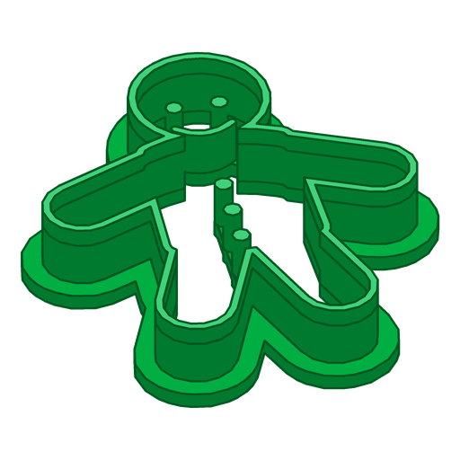

<p align="center"></p>

# Pic2Cookie

Turn a picture into a 3D-printable cookie cutter or coaster. Upload an SVG, or a PNG/JPG/WebP that gets traced, choose a size, and download an STL, a 3MF or a ready-to-slice **Bambu Studio project**. It also tells you how much filament it takes.

### Cookie cutters

- **Outer blade** along the shape, **Inner blades** around holes (the donut's hole), shorter **Imprint blades** for details (glazing, sprinkles), all standing on a **Flange**.
- Imprint blades are held by thin **Bridges** or a **Back plate**.
- Click any part of the picture to switch it between Hole, Imprint blade and Ignore.

### Coasters

- A **Plate** (round, square, rounded square, or the picture's own **Silhouette**) with the picture as its **Motif** on top: as a flush two-colour **Inlay** (AMS), **Raised**, or **Engraved**.
- Optional **Rim**, **Foot recesses** for stick-on pads, and a **Bottle opener** tab with a **Coin insert** (2 € by default): the Bambu project pauses at the right layer so you can drop the coin in.
- The Bambu project puts the Plate on AMS slot 1 and the Motif on slot 2; the Filament estimate is split per colour.

### Both

- Choose Cookie cutter or Coaster when you upload; switch a Design at any time.
- The page is in English and German (switch at the top; it follows the browser's language at first).
- Bambu presets for the A1 mini, A1, P1S, P2S, X1C and H2D, plus an "Open in Bambu Studio" button.
- CLI, web API and a React frontend. Runs locally, or in Kubernetes with S3 or a volume (iSCSI, Longhorn, …).

The vocabulary is in [GLOSSARY.md](GLOSSARY.md); the big decisions in [docs/adr](docs/adr).

## Run it locally

Needs [uv](https://docs.astral.sh/uv/) (it fetches Python 3.15) and Node.js 24+.

```sh
scripts/start.sh          # builds the frontend, serves everything on http://127.0.0.1:8000
scripts/start.sh --dev    # API with auto-reload on :8000 + Vite dev server on http://127.0.0.1:5173
```

Designs are stored in `./data` (one folder each, with a `design.json`).

## Command line

```sh
uv run pic2cookie make donut.svg -o donut.stl --size 70
uv run pic2cookie make cat.png -o cat.bambu.3mf --printer a1mini --material petg --price 20
uv run pic2cookie make drawing.svg --role r3=hole --roles-svg roles.svg   # change a Role, keep the result
uv run pic2cookie make roles.svg -o again.3mf                             # role-marked SVGs come back unchanged
uv run pic2cookie make logo.svg --product coaster --shape rounded -o logo.bambu.3mf
uv run pic2cookie make cat.png --product coaster --shape silhouette --opener coin --coin eur1 --feet
uv run pic2cookie make hi.svg --product coaster --motif-style raised -o hi.stl.zip  # one STL per colour
uv run pic2cookie trace photo.png --ink "#c0392b" --tolerance 0.3
uv run pic2cookie printers
uv run pic2cookie designs ls | show <id> | rm <id> | export <id> -o out/
```

`make` prints the Filament estimate and every feature with its Role. `--json` gives machine-readable output.

### How the picture is read (cookie cutters)

- **Filled drawings** (a black donut with a white hole): the shape is the cookie. Enclosed background areas become Holes; ones narrower than `--min-hole` (8 mm) become Imprint blades instead.
- **Line drawings** (black lines on white): the outermost line is the Outer blade; every other line becomes an Imprint blade. Mark a region as a Hole in the frontend, or with `--role`.
- Raster pictures: pick the Ink colour (default black) and a tolerance, or `--ink alpha` for transparent PNGs.
- The cutter is modelled flange-down and mirrored, so the cookie matches the picture once you flip the cutter to cut.

### Coasters

- Every separate piece of Ink is part of the Motif (`m1`, `m2`, …); switch pieces off with `--role m2=ignore` or by clicking them. `--invert-motif` makes the background the Motif.
- The Motif is centred and as large as fits inside the margin (`--margin`, 10 mm); lines thinner than 0.5 mm are widened.
- With `--opener coin`, the print pauses before the layer that closes the coin slot (3.8 mm for a 2 € coin). The Bambu project does that by itself; with STL or 3MF, add the pause in your slicer.

## Configuration

Everything is set with `PIC2COOKIE_*` environment variables or a `.env` file; see [.env.example](.env.example). The defaults run locally without any configuration.

| Setting | Values |
|---|---|
| `PIC2COOKIE_STORAGE__TYPE` | `fs` (folder or mounted volume, default) or `s3` |
| `PIC2COOKIE_DATABASE__URI` | MongoDB URI; when unset, records are `design.json` files |
| `PIC2COOKIE_EXECUTOR` | `inline` (thread pool, default) or `rq` (Redis + `pic2cookie worker`) |
| `PIC2COOKIE_RETENTION__DAYS` | delete Designs not changed for this long |
| `PIC2COOKIE_LOG__LEVEL` / `__FORMAT` / `__ACCESS` | `INFO`; `text` or `json` (the Helm chart uses `json`); `false` drops request logs, which contain IP addresses |
| `PIC2COOKIE_HOSTING__ENABLED` | `true` shows a GitHub link and a privacy notice (on in Compose and Helm, off locally) |
| `PIC2COOKIE_HOSTING__OPERATOR__NAME` / `__ADDRESS` / `__EMAIL` | who runs the instance, named in the privacy notice |

## Docker Compose

```sh
docker compose up                                           # app + MongoDB on :8000
docker compose --profile redis up                           # + Redis and an RQ worker (set PIC2COOKIE_EXECUTOR=rq)
PIC2COOKIE_STORAGE__TYPE=s3 docker compose --profile s3 up  # files in SeaweedFS (S3) instead of a volume
```

## Kubernetes (k3s)

The chart is published to GHCR on every version tag.

```sh
helm install pic2cookie oci://ghcr.io/levinthedoctor/charts/pic2cookie \
  --set ingress.enabled=true --set ingress.host=cookies.home.lan
```

- **Files on a volume** (default): a ReadWriteOnce PVC from your storage class, e.g. iSCSI or Longhorn. With `executor=rq` the worker runs as a second container in the app pod, so it shares the volume.
- **Files in S3**: `--set storage.type=s3,storage.s3.bucket=…,storage.s3.endpointUrl=…,storage.s3.existingSecret=…`. Then `replicaCount` and `worker.replicas` can be raised.
- **MongoDB** is bundled as a single-node StatefulSet, pinned to `amd64` nodes, because a Raspberry Pi 4 cannot run MongoDB 5+. On x86 CPUs without AVX, set `mongodb.image=mongo:4.4`. To use your own, set `mongodb.enabled=false` and `database.uri=…`.
- The image is built for amd64 and arm64, so the app itself runs on a Pi too.
- **Cloudflare Tunnel** instead of an ingress: create a tunnel in the dashboard, store its token with `kubectl create secret generic cloudflared-token --from-literal=token=…`, then `--set cloudflared.enabled=true,cloudflared.existingSecret=cloudflared-token` and point the tunnel's public hostname at the Service URL the install prints.
- Hosting mode is on: set `hosting.operator.name`, `.address` and `.email` so the privacy notice names who runs the instance.

## Development

```sh
uv sync --all-extras
uv run pytest
uv run ruff check . && uv run ruff format --check .
cd frontend && npm ci && npm run lint && npm test && npm run build
uv run python scripts/render_icon.py          # re-render logo and favicons
uv run python scripts/fetch_bambu_profiles.py # refresh Bambu presets
```

GitHub Actions runs all of this on every PR. On `main` and on tags it also builds and pushes the multi-arch image. On `v*` tags it publishes the Helm chart. Docker is only built in CI.

## License

MIT, see [LICENSE](LICENSE).
